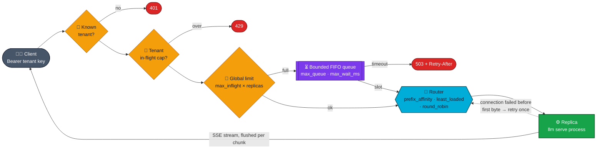
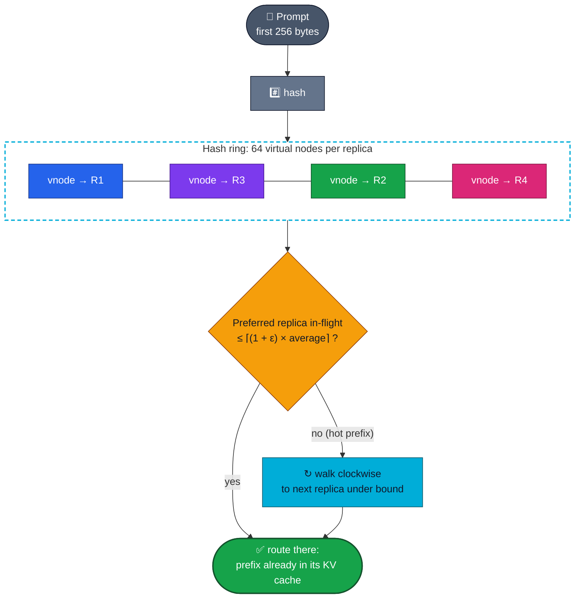
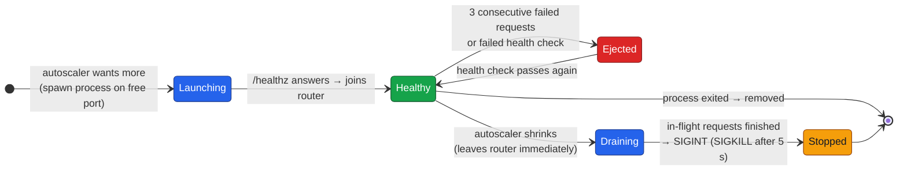
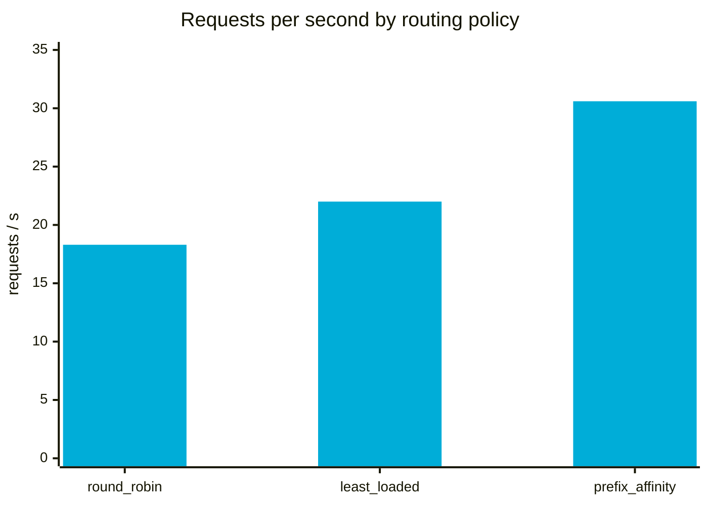
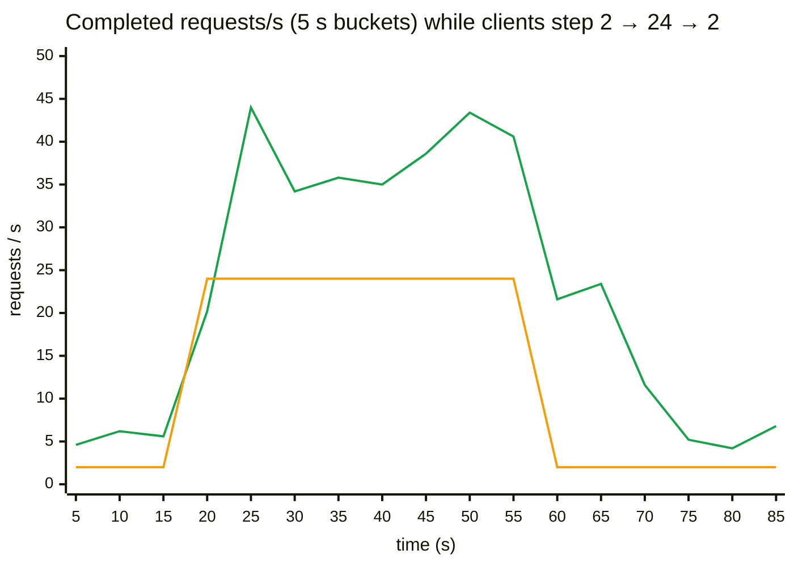

<div align="center">

# 🚦 InferX

### A KV-cache-aware inference gateway and autoscaler for LLM replicas: it routes requests that share a prompt prefix to the replica that already has it cached

**Prefix-affinity consistent hashing with bounded load · admission control & load shedding · health checks & ejection · autoscaling real model processes · streaming passthrough**

<br/>


[**Why**](#-why-cache-aware-routing) · [**Request path**](#%EF%B8%8F-request-path) · [**Routing**](#-routing-consistent-hashing-with-bounded-load) · [**Autoscaling**](#-autoscaling--replica-lifecycle) · [**Results**](#-results) · [**Testing**](#-testing) · [**Run it**](#-running-it)

</div>

---

## 💡 Why cache-aware routing?

Modern LLM engines (vLLM, SGLang, and my own [LLM inference engine](https://github.com/siddhaantxsingh/LLM-INFERENCE-ENGINE)) keep a **paged KV cache with prefix caching**: if a prompt starts with tokens the replica has already seen (a system prompt, few-shot examples, a file header), that prefill is skipped.

A **round-robin load balancer throws that away.** It spreads every prefix across every replica, so each replica's cache keeps evicting the others' prefixes. InferX hashes the prompt prefix onto a ring, so requests that share context land where the context is already cached, and **bounded load** stops a hot prefix from overwhelming a single replica.

| | |
|---|---|
| 🎯 **Routing** | `round_robin`, `least_loaded`, or **`prefix_affinity`**: consistent hashing (64 virtual nodes per replica) with **bounded loads** (ε = 0.25, Mirrokni–Thorup–Zadimoghaddam) |
| 🚧 **Admission control** | Global in-flight cap that scales with replica count · bounded FIFO wait queue · **503 + `Retry-After`** shedding · per-tenant caps → **429** |
| 🩺 **Health** | Active `/healthz` probes · passive **outlier ejection** after 3 failed requests · automatic readmission · one safe retry on connection failure |
| 📈 **Autoscaler** | Launches and **gracefully drains real engine processes**; scales up immediately, scales down after a stabilisation window |
| 🌊 **Proxy** | Streams SSE chunk by chunk · `X-Inferx-Replica` header · `/metrics` with TTFT and latency p50/p99, shed counts, per-replica load |

---

## 🛣️ Request path



<sub>A replica's <code>5xx</code> is passed through, not retried, because generation isn't idempotent under sampling. It still counts toward ejection.</sub>

---

## 🎯 Routing: consistent hashing with bounded load



**Properties, each tested:**
- 🧲 **Stickiness:** a prefix keeps its replica, and only the first `prefix_bytes` matter.
- ⚖️ **Bounded load:** 100 concurrent requests with **one** hot prefix spread so no replica exceeds ⌈1.25 × average⌉ + 1.
- 🔁 **Minimal remapping:** adding a 5th replica moves only about 1/5 of prefixes, and only to the new replica.
- 🩺 **Health-aware:** unhealthy replicas are skipped by every policy.

---

## 📈 Autoscaling & replica lifecycle



**Sizing:** desired = ⌈(in-flight + queued) / `target_inflight_per_replica`⌉, clamped to [min, max]. **Scale up immediately**; scale down to the **maximum desired value over the stabilisation window** (no flapping), one replica per tick. The admission limit follows the pool size.

---

## 📊 Results

### Routing policy: 4 real engine replicas, 16 streaming clients, 16 shared code prefixes



| Policy | Requests/s | **KV-cache hit ratio** | TTFT p50 | Latency p50 | Per-replica requests |
|---|:---:|:---:|:---:|:---:|:---:|
| round_robin | 18.3 | 48% | 256 ms | 607 ms | 187 / 187 / 187 / 187 |
| least_loaded | 22.0 | 47% | 207 ms | 700 ms | 225 / 227 / 208 / 226 |
| **prefix_affinity** | **30.6 (1.68×)** | **66%** | **197 ms** | **454 ms** | 289 / 250 / 340 / 364 |

<sub>Replicas are real <code>llm serve</code> processes from my <a href="https://github.com/siddhaantxsingh/LLM-INFERENCE-ENGINE">LLM inference engine</a> (the 3M-parameter model, 1 thread each, a deliberately tight 2,560-token KV pool). The hit ratio is reported by the engines themselves (<code>usage.cached_tokens</code>). The trade-off is visible in the tail: least-loaded has the best TTFT p99, because it never queues behind a busy replica that holds the prefix.</sub>

### Autoscaler under a 2 → 24 → 2 client step


<sub>🟩 completed requests/s · 🟧 concurrent clients. Replicas went 1 → 4 the moment load arrived, then were drained one per tick after load stayed low: <b>1,911 requests, 0 failed, 0 shed.</b></sub>

### Re-run with a pretrained model: SmolLM2-135M-Instruct replicas

| Policy | Requests/s | KV-cache hit ratio | TTFT p50 |
|---|:---:|:---:|:---:|
| round_robin | 0.18 | 9% | 23.4 s |
| least_loaded | 0.19 | 16% | 26.5 s |
| **prefix_affinity** | **0.20** | **23%** | **20.1 s** |

> [!NOTE]
> **Reported honestly:** prefix affinity had the **highest cache-hit ratio in all 3 repetitions**, but with one CPU thread per 135M replica on a heavily shared 4-vCPU machine, each 120 s run finished only about 25 requests. Caches barely warm up at that count, so the throughput gain (1.07–1.16×) is within noise and the 1.68× above is **not** reproduced here. The autoscaler still went 1 → 3 → 1 with **0 failed and 0 shed** across 3 repetitions. Full method and per-run load averages: [`benchmarks.md`](docs/benchmarks.md)

---

## ✅ Testing

`go test -race ./...` runs in seconds with **no engine binary**: `internal/fake` is a simulated engine with a block-level prefix cache, configurable prefill/decode cost, concurrency slots and **fault injection**.

| Package | What's proven |
|---|---|
| `router` | Stickiness · bounded load under a single hot prefix · ~1/n remapping when adding a replica · unhealthy replicas skipped · `least_loaded` equalises load |
| `gateway` | JSON and SSE passthrough (5 chunks + `[DONE]`) · 401 for unknown keys · **cache hit ratio under affinity ≥ 0.85 and ≥ 0.15 above round robin** · admission: limit 2 + queue 2 → exactly 2 succeed, 8 get 503 + `Retry-After` · 429 per tenant · dead replica retried elsewhere and ejected · 500s passed through and counted · ejected replica readmitted on recovery |
| `autoscale` | Immediate scale-up, capped at max · no scale-down inside the window · one-per-step shrink to min |
| `pool` | **Real processes:** launched and joined after `/healthz` · a retiring replica leaves routing immediately but is **not stopped while a request is in flight** |

**Bugs the tests caught:**
- 🐞 **A data race** (`go test -race`): retiring a replica called `exec.Cmd.Wait` concurrently with the launch goroutine's `Wait`. Now only the launcher waits and closes an `exited` channel.
- 🧪 **An invalid experiment:** prefixes picked with a fixed stride gave each round-robin replica only 4 prefixes, making round robin look as good as affinity. Random selection fixed it.
- 🩺 **A spurious health event:** the health loop probed draining replicas. It now skips them.

---

## 🚀 Running it

```sh
go build -o inferx ./cmd/inferx
./inferx -config configs/example.json            # launches `llm serve` replicas from the engine repo

curl -N localhost:8080/v1/completions -H 'Authorization: Bearer change-me-team-a' \
     -d '{"prompt":"import os\n","max_tokens":16,"stream":true}'

go test -race ./...                              # simulated engine, no binaries needed
bench/run.sh                                     # real-engine benchmark (needs ../llm-inference-engine)
bench/run_smollm2.sh 2026-10-15 3                # same with SmolLM2-135M replicas
```

<details>
<summary><b>⚙️ Example config</b></summary>

<br/>

```json
{
  "listen": "127.0.0.1:8080",
  "policy": "prefix_affinity",
  "prefix_bytes": 256,
  "replica_command": ["../llm-inference-engine/target/release/llm", "serve", "--listen", "127.0.0.1:{port}", "..."],
  "min_replicas": 1,
  "max_replicas": 4,
  "target_inflight_per_replica": 4,
  "max_inflight_per_replica": 16,
  "max_queue": 256,
  "max_wait_ms": 5000,
  "scale_down_after_s": 30,
  "tenants": {"change-me-team-a": "team-a", "change-me-team-b": "team-b"},
  "tenant_max_inflight": {"team-b": 8}
}
```

</details>

---

## ⚠️ Limitations

- **CPU replicas only.** GPU replicas, multi-GPU placement and GPU-memory-aware routing aren't done (no GPU available). See [NEBULA_GPU_CLOUD](https://github.com/siddhaantxsingh/NEBULA_GPU_CLOUD) for the GPU scheduling side.
- **Routing uses a byte prefix, not tokens.** Shared prefixes shorter than `prefix_bytes` spread across replicas.
- **Single gateway instance:** admission state and routing tables are in memory.
- **The autoscaler only sees request counts.** It doesn't use tokens/s, KV occupancy, latency SLOs or model load time (2–25 s for SmolLM2), and it runs local processes only.
- **Static API keys, no TLS.** One retry only, with no hedging.

More: [`design.md`](docs/design.md) · [`testing.md`](docs/testing.md) · [`limitations.md`](docs/limitations.md) · [`requirements.md`](docs/requirements.md)

---

## 📁 Repository layout

```text
INFERX/
├── cmd/
│   ├── inferx/        🚦 the gateway
│   ├── loadgen/       📊 streaming load generator
│   └── fakeengine/    🧪 fake replica process for pool tests
├── internal/
│   ├── router/        🎯 round robin · least loaded · prefix affinity (bounded-load ring)
│   ├── admit/         🚧 global limit, queue, shedding, tenant caps
│   ├── pool/          ⚙️ process launch, health, ejection, graceful drain
│   ├── autoscale/     📈 sizing + stabilisation window
│   ├── gateway/       🌊 HTTP proxy, SSE streaming, retries, metrics
│   └── fake/          🧪 simulated engine with prefix cache + fault injection
├── bench/             📊 run scripts, prefix workload, recorded results
├── configs/           ⚙️ example.json
└── docs/              📖 design · testing · benchmarks · limitations · requirements
```

---

<div align="center">

**Send the request to where its context already lives.**

<br/>

Built by **[Siddhant Singh](https://github.com/siddhaantxsingh)** · <sub>MIT License</sub>

</div>
